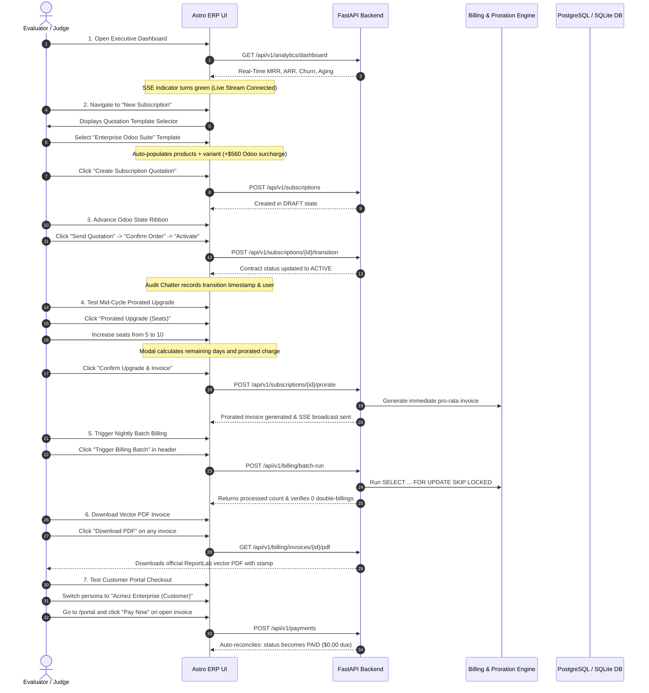

# Brightloop Software Subscription & Recurring Billing ERP
### *Oddo Hackathon Solution — Enterprise Recurring Revenue & Subscription Platform*

[](https://fastapi.tiangolo.com)
[](https://www.postgresql.org)
[](https://sqlite.org)
[](https://astro.build)
[](https://tailwindcss.com)
[](LICENSE)

---

## 📖 Executive Summary & Engineering Philosophy

**Brightloop Software Subscription Management System** is a mission-critical, financial-grade recurring billing and subscription ERP built for high-throughput SaaS operations. Inspired by **Odoo ERP’s ergonomics**, it unifies catalog management, variant price matrices, contract state machines, automated batch billing, multi-tier discount engines, tax jurisdictions, payment reconciliation, and real-time financial reporting.

### Core Engineering Invariants:
1. **Comment the "Why", Not the "What"**: Code documents business invariants, concurrency models, and security principles (e.g. why `SKIP LOCKED` prevents deadlock during batch billing).
2. **Zero Double-Billing Guarantee**: Enforced by composite database constraints (`INV-{sub_id}-{period_start}`) combined with atomic row locks.
3. **Odoo-Inspired ERP Ergonomics**: Chevron workflow ribbons, smart breadcrumbs, multi-tab contract forms, interactive audit chatter feeds, and 1-click persona switching.
4. **Complete Implementation**: Zero placeholders, zero mock endpoints. Every button triggers real backend transactions and state transitions.
5. **Zero-Config Dual-Mode Execution**: Runs anywhere with **Docker Compose** (PostgreSQL 16) or **Locally without Docker** (Async SQLite zero-config fallback).

---

## 🏛️ System Architecture


---

## 📋 Prerequisites & System Requirements

Before installing, ensure your machine has the following tools installed:

| Tool | Minimum Version | Recommended Version | Purpose |
|---|---|---|---|
| **Python** | 3.10+ | 3.11 or 3.12 | Backend API, SQLAlchemy, ReportLab, APScheduler |
| **Node.js** | 18.0+ | 20.x or 22.x LTS | Astro 5 frontend and Tailwind CSS v4 compiler |
| **npm** | 9.0+ | 10.x+ | Frontend dependency management |
| **Git** | Any modern version | Latest | Version control and repository cloning |
| **Docker** *(Optional)* | 24.0+ | Latest Desktop | Containerized multi-service deployment |

> [!IMPORTANT]
> **Working Directory Notice**:
> - **Backend Commands**: You **must** change into the `backend/` directory (`cd backend`) before running any Python, pip, uvicorn, seed, or test commands.
> - **Frontend Commands**: You **must** change into the `frontend/` directory (`cd frontend`) before running any npm or astro commands.

### Verify Your Installations:
Open your terminal (PowerShell, Command Prompt, or Bash) and run:
```bash
python --version   # Should output: Python 3.10.x or higher
node --version     # Should output: v18.x, v20.x, or v22.x
npm --version      # Should output: 9.x or 10.x
```

---

## 🚀 Complete Installation Guide

You can run Brightloop either **Locally (Without Docker — Zero Config)** or using **Docker Compose (All-in-One)**.

---

### Option 1: Local Setup Without Docker (Recommended for Rapid Testing)

> **Zero Database Configuration Required**: In local mode, Brightloop automatically defaults to an asynchronous SQLite database (`brightloop.db`). You do not need to install or configure PostgreSQL.

#### Step 1: Clone the Repository
```bash
git clone https://github.com/richard-pius/oddo-hackathon-solution.git
cd oddo-hackathon-solution
```

#### Step 2: Install Backend Dependencies
Open a terminal in the root directory:
```bash
cd backend

# (Optional but recommended) Create and activate a Python virtual environment:
# On Windows (PowerShell):
python -m venv venv
.\venv\Scripts\Activate.ps1

# On Windows (Command Prompt cmd.exe):
# python -m venv venv
# .\venv\Scripts\activate.bat

# On macOS / Linux:
# python3 -m venv venv
# source venv/bin/activate

# Install all backend requirements:
pip install -r requirements.txt
```

> **Note on Windows PowerShell**: If you receive a script execution policy restriction error when activating your virtual environment, run:
> ```powershell
> Set-ExecutionPolicy -ExecutionPolicy RemoteSigned -Scope CurrentUser
> ```

#### Step 3: Seed the Database
Run the seed script to create the database schema and populate realistic ERP subscription contracts, catalog items, tax jurisdictions, invoices, and demo accounts:
```bash
python seed_brightloop.py
```
*Expected Output:*
```text
🌱 Seeding Brightloop database...
  👤 Created 12 users
  📦 Created 8 products
  🏷️  Created 6 product variants
  📋 Created 4 subscription plans
  💰 Created 3 tax rules
  🎁 Created 3 discount rules
  📝 Created 2 quotation templates with 6 lines
  📄 Created 9 subscriptions with lines
  🧾 Created 10 invoices and 5 payments
✅ Brightloop seed complete!
```

#### Step 4: Install Frontend Dependencies
Open a second terminal window in the project root:
```bash
cd frontend
npm install
```

---

### Option 2: Docker Compose Setup (Single Command)

If you have Docker Desktop installed, you can launch PostgreSQL 16, the FastAPI backend, and the Astro frontend in isolated containers with a single command:

```bash
docker-compose up --build
```

To run in the background (detached mode):
```bash
docker-compose up -d --build
```

To stop containers:
```bash
docker-compose down
```
To stop containers and delete database volumes for a clean slate:
```bash
docker-compose down -v
```

---

## ▶️ How to Run the Application

> [!CAUTION]
> Always navigate to the target module directory first:
> - Backend commands **fail** if run from the repository root; you must run `cd backend` first.
> - Frontend commands **fail** if run from the repository root; you must run `cd frontend` first.

### Running Locally (Two Terminals)

#### Terminal 1 — Start Backend Server (FastAPI):
```bash
# 1. Navigate to the backend directory
cd backend

# 2. (Optional) Activate virtual environment if configured (e.g. .\venv\Scripts\Activate.ps1)
# 3. Launch Uvicorn server
uvicorn app.main:app --host 127.0.0.1 --port 8000 --reload
```
*Backend is now live at `http://127.0.0.1:8000` with automated background billing cron active.*

#### Terminal 2 — Start Frontend Server (Astro):
```bash
# 1. Navigate to the frontend directory
cd frontend

# 2. Launch Astro dev server
npm run dev
```
*Frontend is now live at `http://localhost:4321`.*

---

## 🌐 URLs & Service Endpoints Cheat Sheet

| Service | Local URL | Docker Compose URL | Description |
|---|---|---|---|
| **Web ERP & Portal** | [http://localhost:4321](http://localhost:4321) | [http://localhost:4321](http://localhost:4321) | Main Odoo-inspired ERP UI & Customer Portal |
| **Interactive API Docs (Swagger)** | [http://localhost:8000/docs](http://localhost:8000/docs) | [http://localhost:8000/docs](http://localhost:8000/docs) | FastAPI interactive Swagger UI |
| **API Reference (ReDoc)** | [http://localhost:8000/redoc](http://localhost:8000/redoc) | [http://localhost:8000/redoc](http://localhost:8000/redoc) | Alternative structured API documentation |
| **Real-Time SSE Stream** | [http://localhost:8000/api/v1/stream/events](http://localhost:8000/api/v1/stream/events) | [http://localhost:8000/api/v1/stream/events](http://localhost:8000/api/v1/stream/events) | Persistent Server-Sent Events push feed |
| **OpenAPI Schema** | [http://localhost:8000/openapi.json](http://localhost:8000/openapi.json) | [http://localhost:8000/openapi.json](http://localhost:8000/openapi.json) | Raw OpenAPI v3 specification |

---

## 👥 Pre-Seeded Demo Accounts & Credentials

Sign in at [http://localhost:4321/login](http://localhost:4321/login) using any of the seeded credentials. Once signed in, the header displays the authenticated user's name, avatar initials, and role badge (with a dedicated **Sign Out** button):

| Persona | Role | Email | Password | Access & Permissions |
|---|---|---|---|---|
| **Alex Morgan** | Administrator | `admin@brightloop.io` | `BrightloopAdmin2026!` | Full administrative access, staff provisioning, password reset & account deletion |
| **Sarah Chen** | Finance Lead | `finance@brightloop.io` | `BrightloopFinance2026!` | Billing runs, invoice management, payment reconciliation, aging reports |
| **Acmez Enterprise** | Customer Tenant | `customer@brightloop.io` | `BrightloopCustomer2026!` | Isolated customer portal, view contracts, card payments |

---

## 🛠️ Troubleshooting & Common Questions

### 1. IDE shows `Cannot find module 'sqlalchemy'` (Pyrefly / Pyright squiggly)
- **Why**: Python language servers in VS Code cache the list of site-packages at startup. If you opened the workspace before running `pip install -r requirements.txt`, the editor holds a stale cache.
- **Fix**:
  1. Press <kbd>Ctrl</kbd> + <kbd>Shift</kbd> + <kbd>P</kbd> in VS Code.
  2. Select **`Developer: Reload Window`** or **`Python: Restart Language Server`**.
  3. Ensure your interpreter is set to your Python environment (<kbd>Ctrl</kbd> + <kbd>Shift</kbd> + <kbd>P</kbd> ➔ **`Python: Select Interpreter`**).
  *(The repository already includes pre-configured [`.vscode/settings.json`](.vscode/settings.json) and [`pyrightconfig.json`](pyrightconfig.json) for automatic path resolution).*

### 2. How do I reset or re-seed the local database?
- Simply delete `backend/brightloop.db` and re-run:
  ```bash
  cd backend
  python seed_brightloop.py
  ```

### 3. Port `8000` or `4321` is already occupied
- To run the backend on a different port (e.g. 8001):
  ```bash
  uvicorn app.main:app --host 127.0.0.1 --port 8001 --reload
  ```
- To run the frontend on a different port:
  ```bash
  npx astro dev --port 4322
  ```

### 4. Running unit & integration tests
```bash
cd backend
python -m unittest discover tests -v
```

---

## 📂 Project Structure

```text
oddo-hackathon-solution/
├── .env.example               # Complete environment variable template
├── .gitignore                  # Production Git ignore rules
├── .vscode/
│   └── settings.json           # IDE interpreter and import path settings
├── pyrightconfig.json          # Language server configuration
├── docker-compose.yml          # Multi-container orchestration (DB, API, UI)
├── LICENSE                     # MIT Open Source License
├── requirements.txt            # Root Python dependencies delegate
├── README.md                   # System documentation and evaluator guide
│
├── backend/
│   ├── Dockerfile              # Python 3.11 Slim container definition
│   ├── requirements.txt        # Pinned production Python dependencies
│   ├── seed_brightloop.py      # Enterprise seed script with realistic data
│   ├── alembic.ini             # Database migration configuration
│   ├── alembic/                # Migration scripts and environment
│   ├── tests/                  # Automated unit and integration test suite
│   │   ├── __init__.py
│   │   ├── test_auth.py
│   │   └── test_config.py
│   └── app/
│       ├── main.py             # FastAPI entrypoint, lifespan, CORS, and cron
│       ├── config.py           # Pydantic v2 settings (SQLite local / Postgres Docker)
│       ├── database.py         # Async SQLAlchemy engine & session factory
│       ├── models.py           # 13 relational entities with composite indexes
│       ├── schemas.py          # Strict Pydantic input/output validation schemas
│       ├── services/
│       │   ├── auth_service.py         # JWT, Argon2/Bcrypt, and RBAC guards
│       │   ├── billing_engine.py       # Batch billing, dunning, and ReportLab PDF
│       │   ├── subscription_service.py # Lifecycle state machine & proration
│       │   └── continuous_stream.py    # Async SSE broadcaster
│       └── routers/
│           ├── auth.py                 # Login, register, me, API keys
│           ├── catalog.py              # Products, variants (+560), plans, discounts
│           ├── subscriptions.py        # Lifecycle transitions, chatter, prorating
│           ├── billing.py              # Invoices, batch billing, PDF stream
│           ├── payments.py             # Ledger recording, auto-reconciliation
│           ├── analytics.py            # MRR, ARR, churn, aging report
│           └── stream.py               # Real-time SSE push endpoint
│
└── frontend/
    ├── Dockerfile              # Node 22 container definition
    ├── package.json            # Astro 5 & Tailwind CSS dependencies
    ├── astro.config.mjs        # Astro configuration with Vite Tailwind plugin
    ├── README.md               # Frontend-specific documentation
    └── src/
        ├── middleware.ts       # Route protection & auth session guard
        ├── layouts/
        │   └── Layout.astro    # Master ERP layout, SSE listener, role switcher
        ├── styles/
        │   └── global.css      # ERP status ribbon styles & theme tokens
        ├── lib/
        │   └── api.ts          # Centralized API client & JWT storage
        └── pages/
            ├── index.astro                 # Executive Finance Dashboard
            ├── login.astro                 # Authentication sign-in portal
            ├── register.astro              # Tenant customer onboarding
            ├── subscriptions/
            │   ├── index.astro             # Subscriptions ledger with status filters
            │   ├── new.astro               # Quotation wizard & template auto-fill
            │   └── [id].astro              # Odoo form view with chatter & proration
            ├── invoices/
            │   ├── index.astro             # Invoices ledger & payment modal
            │   └── [id].astro              # Tax invoice document & PDF download
            ├── payments/
            │   └── index.astro             # Payment history & ledger
            ├── catalog/
            │   └── index.astro             # Product matrices & variant extra prices
            ├── rules/
            │   └── index.astro             # Plans, 18% GST tax rules & discounts
            └── portal/
                └── index.astro             # Customer self-service checkout portal
```

---

## 🌟 Key Domain Features & Business Logic

### 1. Odoo ERP User Experience
- **Chevron Status Ribbon**: Visual state pipeline on subscriptions (`DRAFT` ➔ `QUOTATION` ➔ `CONFIRMED` ➔ `ACTIVE` ➔ `CLOSED`).
- **Interactive Chatter & Audit Trail**: Real-time logging of status transitions, timestamps, user actions, and team collaboration notes.
- **1-Click Persona Switcher**: Top-right dropdown allows examiners to instantly toggle between **Admin**, **Finance Lead**, and **Customer** personas without re-typing credentials.

### 2. Product Catalog & Variant Matrices
- Products support configurable attributes with price extra surcharges (e.g. Brand: **Odoo Variant adds +$560.00** to the line price).
- Support for **Service** (recurring SaaS), **Consumable**, and **Storable** product types.
- Pre-configured **Quotation Templates** that populate bundles, plans, and terms in a single click.

### 3. Automated Recurring Billing Engine
- **APScheduler** triggers nightly batch run at 00:05 UTC (can also be triggered manually on-demand from the UI).
- **Zero Double-Billing Guarantee**:
  - Row-level lock: `SELECT ... FOR UPDATE SKIP LOCKED` ensures concurrent billing workers never process the same chunk or cause deadlocks.
  - Unique composite constraint: `INV-{subscription_id}-{period_start}` causes database-level rejection of any duplicate charge attempt.
- **Automated Dunning Sequences**: Retries and flags overdue invoices across Days 1, 3, 5, and 7.

### 4. Mid-Cycle Prorated Seat Expansions
- When a customer expands seats mid-period, the proration engine calculates:
  $$\text{Prorated Charge} = (\Delta\text{Seats} \times \text{Unit Price}) \times \frac{\text{Days Remaining}}{\text{Total Cycle Days}}$$
- Generates an immediate prorated invoice while updating future recurring subscription quantities for subsequent cycles.

### 5. ReportLab Vector PDF Invoice Generator
- Server-side generated high-resolution vector PDF invoices.
- Features itemized line items, tax breakdowns, company registration numbers, customer addresses, and official status stamps.
- Downloadable directly from the UI or via API endpoint `/api/v1/billing/invoices/{id}/pdf`.

### 6. Real-Time Telemetry via Server-Sent Events (SSE)
- Persistent HTTP connection at `/api/v1/stream/events` with query token auth support.
- Live event broadcasts when payments are recorded, invoices generated, or contracts transition state.
- Dynamic sidebar activity ticker and visual pulse indicator update with zero page reloads.

---

## 🧪 Evaluator Verification Walkthrough (7 Steps)

Follow this structured workflow to test every capability of the platform:



---

## 📡 REST API Reference

All endpoints are versioned under `/api/v1/` (with automatic backward-compatible path rewriting for `/api/`):

### Authentication & Users
- `POST /api/v1/auth/login` — Authenticate and receive JWT access token.
- `POST /api/v1/auth/register` — Create new customer user account.
- `GET /api/v1/auth/me` — Retrieve active profile and role.
- `GET /api/v1/auth/users` — List directory of all users (Admin only).
- `POST /api/v1/auth/staff` — Provision new internal staff account (Admin only).
- `DELETE /api/v1/auth/users/{user_id}` — Permanently delete user account with safety cascading (Admin only).
- `PUT /api/v1/auth/users/{user_id}/password` — Change/reset user password with complexity validation (Admin only).

### Catalog & Pricing
- `GET /api/v1/catalog/products` — List products with variant matrices and price extras.
- `POST /api/v1/catalog/products` — Create new catalog item.
- `POST /api/v1/catalog/products/{product_id}/variants` — Add attribute price extra surcharge variant (e.g. +$560.00).
- `GET /api/v1/catalog/plans` — List billing plans (Monthly Flex, Annual Commitment, Daily Dev).
- `GET /api/v1/catalog/discounts` — List volume tiers and promotional coupons.
- `GET /api/v1/catalog/taxes` — List active tax jurisdictions (18% GST / IGST).
- `GET /api/v1/catalog/quotation-templates` — List enterprise bundles.

### Subscriptions & Contracts
- `GET /api/v1/subscriptions` — Paginated contract ledger with status filters.
- `POST /api/v1/subscriptions` — Create new subscription contract.
- `GET /api/v1/subscriptions/{id}` — Retrieve full subscription form data.
- `POST /api/v1/subscriptions/{id}/transition` — Advance state machine (`quotation`, `confirmed`, `active`, `paused`, `cancelled`, `closed`).
- `POST /api/v1/subscriptions/{id}/prorate` — Mid-cycle seat upgrade with immediate pro-rata invoice.
- `POST /api/v1/subscriptions/{id}/generate-invoice` — On-demand itemized invoice generation for active contracts.
- `GET /api/v1/subscriptions/{id}/audit` — Retrieve audit trail.
- `POST /api/v1/subscriptions/{id}/chatter` — Post a discussion note to contract chatter.

### Invoices & Billing
- `GET /api/v1/billing/invoices` — List invoices with balance due and status filters.
- `GET /api/v1/billing/invoices/{id}` — Invoice detail view.
- `POST /api/v1/billing/batch-run` — Trigger idempotent batch billing run.
- `POST /api/v1/billing/run-billing` — Alias for batch billing run.
- `GET /api/v1/billing/invoices/{id}/pdf` — Download ReportLab vector PDF invoice (supports `?token=` parameter).

### Payments & Reconciliation
- `GET /api/v1/payments` — Payment ledger and transaction history.
- `POST /api/v1/payments` — Record payment; auto-reconciles invoice to `PAID` when balance is cleared.

### Analytics & Stream
- `GET /api/v1/analytics/dashboard` — Unified KPIs (MRR, ARR, active contracts, churn, overdue aging).
- `GET /api/v1/stream/events` — Server-Sent Events (SSE) live push stream.

---

## 🗄️ Database Schema & Entities

The system uses 13 relational models with strict constraints and indexes:

1. **`users`**: RBAC roles (`admin`, `internal_staff`, `customer`), hashed passwords, active status.
2. **`products`**: Type (`service`, `consumable`, `storable`), base price, active flag.
3. **`product_variants`**: Attributes JSON, price extra surcharge (e.g. `+$560.00`), SKU.
4. **`subscription_plans`**: Billing interval (`day`, `week`, `month`, `year`), interval count, renewal policies.
5. **`tax_rules`**: Tax rate percentage, jurisdiction, compound flag, product type applicability.
6. **`discount_rules`**: Type (`percentage`, `fixed_amount`, `tiered_quantity`), value, minimum quantity thresholds.
7. **`quotation_templates` & `quotation_template_lines`**: Predefined quotation structures.
8. **`subscriptions`**: State machine, billing dates, customer ID, plan ID, payment terms.
9. **`subscription_lines`**: Product, variant, quantity, unit price, tax IDs, line subtotal.
10. **`subscription_audits`**: State change ledger, user ID, reason, timestamp.
11. **`invoices`**: Idempotency key, issue/due dates, subtotal, tax total, amount paid, amount due, status.
12. **`invoice_lines`**: Itemized invoice line items with taxes and discounts.
13. **`payments`**: Payment method, amount, reference note, transaction date, recorded by.

---

## 📄 License

This solution is developed for the **Oddo Hackathon** under the MIT License.
